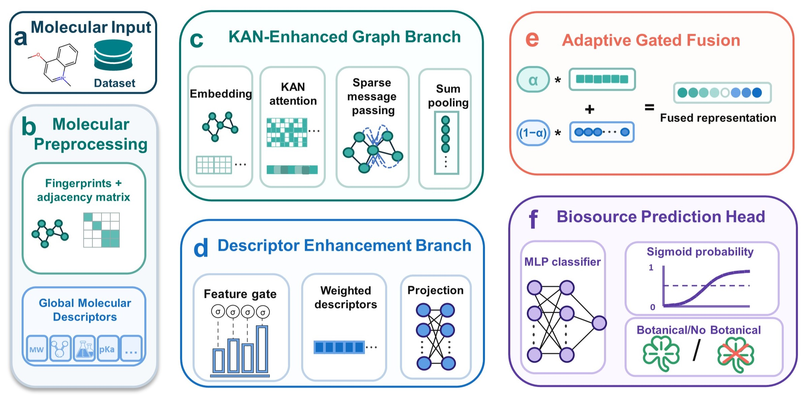

# KEGD-NP
a dual-branch molecular classification framework that integrates molecular graph representations with 208 RDKit molecular descriptors


<div align="center">
  
</div>


# Installation
## Install Python

Python 3.11.0 is recommended.

[python](https://www.python.org)


## Install dependent packages

Install the required packages using:

pip install -r requirements.txt


# KEGD-NP

A dual-branch molecular classification framework integrating molecular graph representations with 208 RDKit molecular descriptors for natural product biosource prediction.

<div align="center">
  
</div>

## Overview

Predicting the biological sources of natural products supports chemical annotation and molecular discovery. KEGD-NP integrates learned molecular graph representations with global molecular descriptors to capture complementary structural information for biosource prediction.

The framework consists of three main components:

- **KAN-enhanced multihead graph attention encoder:** learns molecular graph representations.
- **Gated descriptor encoder:** processes 208 RDKit molecular descriptors.
- **Adaptive gated fusion module:** integrates graph representations and descriptor features for binary classification.

Each biosource task is modeled independently as a binary classification problem. This repository uses **botanical-source prediction** as the primary example for training, inference, and SHAP analysis.

## Dataset

The data used in this study were obtained from **NPBS Atlas**, a public resource containing natural products and their biological source annotations.

- **Database:** [NPBS Atlas](https://biochemai.cstspace.cn/npbs/)
- **Database publication:** [NPBS Atlas: a comprehensive data resource for exploring the biological sources of natural products](https://doi.org/10.1186/s13321-025-01116-y)

The study considered five biosource labels:

| Biosource | Numeric label column |
|---|---|
| Botanical | `Botanical_num` |
| Zoological | `Zoological_num` |
| Bacterial | `Bacterial_num` |
| Fungal | `Fungi_num` |
| Marine | `Marine_num` |

These labels are evaluated through separate binary classification tasks rather than a single five-class classification task.

The balanced datasets used in the experiments were derived from NPBS Atlas. The original database and the task-specific balanced datasets should therefore be distinguished.

### Input format

For botanical-source training and SHAP analysis, the input CSV must contain:

| Column | Description |
|---|---|
| `SMILES` | Molecular structure represented as a SMILES string |
| `Botanical_num` | Binary botanical-source label: `1` or `0` |
| `Identifier` | Molecular identifier, when available |

For inference, the input may be either:

- A CSV containing a `SMILES` column.
- A headerless file containing one SMILES string per line.

The small files included in `data/` illustrate the input format. Full training and SHAP analysis require a sufficiently large labeled dataset that supports the specified stratified split and sampling procedure.

## Reported Results

### Botanical-source classification

On the balanced NPBS Atlas dataset, KEGD-NP outperformed the evaluated baseline models in botanical-source binary classification.

| Metric | Reported value |
|---|---:|
| Accuracy | 0.9238 |
| F1 score | 0.9244 |
| Recall | 0.9317 |

Ablation experiments supported the contributions of the KAN-enhanced graph encoder and adaptive gated fusion module.

These values are results reported in the study, rather than expected results from the small example files in this repository.

### Application to MS/MS candidate annotation

Predicted botanical-source probabilities were used as an auxiliary prior for soft re-ranking of positive-ion candidates generated by DeepMass.

Among **2,878 evaluable unknown compounds**, top-1 performance was preserved, while the numbers of correct candidates increased at larger candidate-list cutoffs.

| Candidate cutoff | Change in correct candidates |
|---|---:|
| Top-1 | Unchanged |
| Top-5 | +10 |
| Top-20 | +13 |
| Top-50 | +13 |

This application evaluates botanical-source probabilities as complementary information for candidate prioritization in MS/MS annotation.

## Installation

### Python

Python **3.11.0** was used in the tested environment.

Download Python from the [official Python website](https://www.python.org/).

### Dependencies

Install the base dependencies using:

```bash
python -m pip install -r requirements.txt
```

For SHAP analysis, use an environment with SHAP available. The original tested analysis environment uses **SHAP 0.51.0**. See `environment_versions.txt` for the recorded package versions.

The environment record describes the existing tested environment; it is not a separately validated clean-install lock file.

## Repository Structure

```text
KEGD-NP/
├── train.py
├── test.py
├── explain_shap.py
├── requirements.txt
├── environment_versions.txt
├── README.md
├── data/
│   ├── 1.csv
│   └── 11.csv
├── figure/
│   └── workflow.jpg
├── model/
│   ├── classifier.py
│   ├── kan2.py
│   ├── preprocess.py
│   └── shap_helpers.py
└── weight/
    ├── best_Botanical.pt
    ├── descriptor_names.json
    └── dict/
        ├── atom_dict.pickle
        ├── bond_dict.pickle
        ├── fingerprint_dict.pickle
        └── edge_dict.pickle
```

- `train.py` retains the original training procedure.
- `test.py` loads a trained model and predicts botanical-source probabilities.
- `explain_shap.py` performs descriptor attribution and saves a single beeswarm plot.
- `model/shap_helpers.py` contains the fixed-graph prediction and validation functions used during SHAP analysis.

## Training

Configure the dataset and target label in `train.py`:

```python
CSV_PATH = str(ROOT / "data" / "your_Botanical_dataset.csv")
LABEL_COL = "Botanical"
```

Run training:

```bash
python train.py
```

On Windows terminals requiring UTF-8 output, use:

```bash
python -X utf8 train.py
```

### Training settings

| Setting | Value |
|---|---|
| Task | Binary classification |
| Random seed | 42 |
| Data split | Stratified, approximately 8:1:1 |
| Batch size | 128 |
| Maximum epochs | 200 |
| Model output | A single logit |
| Loss | `BCEWithLogitsLoss` with training-set class weighting |
| Optimizer | Adam |
| Initial learning rate | `1e-3` |
| Weight decay | `1e-5` |
| Gradient clipping | Maximum norm of 1.0 |
| Learning-rate scheduler | `ReduceLROnPlateau` |
| Scheduler factor | 0.5 |
| Scheduler patience | 8 |
| Minimum learning rate | `1e-6` |
| Early-stopping patience | 12 |
| Classification threshold | 0.5 |

The learning-rate scheduler and early stopping monitor validation loss. Checkpoints are saved according to validation accuracy and validation loss, with final evaluation performed on the held-out test set.

Evaluation metrics include loss, accuracy, precision, recall, and F1 score.

Training outputs are saved under:

```text
results/yesglo/
```

The original stratified splitting procedure is retained. Insufficient class counts cause an error rather than an automatic switch to a different splitting strategy.

## Inference

Run botanical-source prediction using the supplied checkpoint:

```bash
python test.py
```

The default input and checkpoint are:

```text
Input:       data/11.csv
Checkpoint:  weight/best_Botanical.pt
```

Use another input file:

```bash
python test.py --csv data/your_molecules.csv
```

Save predictions to a CSV:

```bash
python test.py --csv data/your_molecules.csv --output results/predictions.csv
```

Run inference on CPU:

```bash
python test.py --device cpu
```

The output includes:

- Botanical-source probability.
- Predicted binary label.
- Processing status for each molecule.

A probability greater than or equal to **0.5** is assigned label `1`.

The model checkpoint must be used with its corresponding feature dictionaries and descriptor definitions. Inputs without reference labels support prediction but do not support calculation of classification accuracy or F1 score.

## SHAP Analysis

SHAP analysis evaluates the contributions of the 208 RDKit molecular descriptors to model predictions.

For each explained molecule, its **graph branch is held fixed**, while Kernel SHAP perturbs the molecular descriptor vector using values from the background samples. The descriptor encoder, adaptive fusion gate, and classification layers are recomputed for these perturbed inputs.

### Analysis settings

| Setting | Value |
|---|---|
| Background samples | 300, randomly selected from the training set |
| Explanation samples | 2,000, selected from the test set |
| Explanation-label balance | 1,000 positive and 1,000 negative samples |
| Kernel SHAP samples | 1,000 |
| `l1_reg` | 0 |
| Importance summary | Mean absolute SHAP value |
| Displayed descriptors | Top 20 |
| Device | CPU |

Run botanical-source SHAP analysis:

```bash
python explain_shap.py --csv data/your_Botanical_dataset.csv
```

The default checkpoint is:

```text
weight/best_Botanical.pt
```

Only one analysis figure is saved:

```text
results/shap/shap_beeswarm_top20.png
```

The plot summarizes descriptor contributions under a fixed molecular graph representation. It does not represent joint attribution over graph structure and molecular descriptors.

The original Dataset preprocessing and caching procedure is retained. Preprocessing caches may therefore be loaded or created separately from the single analysis figure.

The study compared descriptor contributions across five biosource tasks to examine shared and task-specific physicochemical patterns. The script provided here demonstrates the Botanical task.

## Reproducibility Notes

- Keep the preprocessing procedure, descriptor definitions, and model configuration consistent with the selected checkpoint.
- Use the same dataset ordering and filtering results when reconstructing a historical data split.
- Keep each checkpoint paired with its corresponding feature dictionaries and preprocessing artifacts.
- Example data are intended to demonstrate file formats and code usage, rather than reproduce the reported benchmark results.
- Complete experimental reproduction requires the corresponding full datasets and trained artifacts.

## Acknowledgements

We acknowledge NPBS Atlas for providing the natural product biological-source data used in this study, and the developers of RDKit, PyTorch, and SHAP for their open-source tools.

Please cite the original NPBS Atlas publication when using its data.
